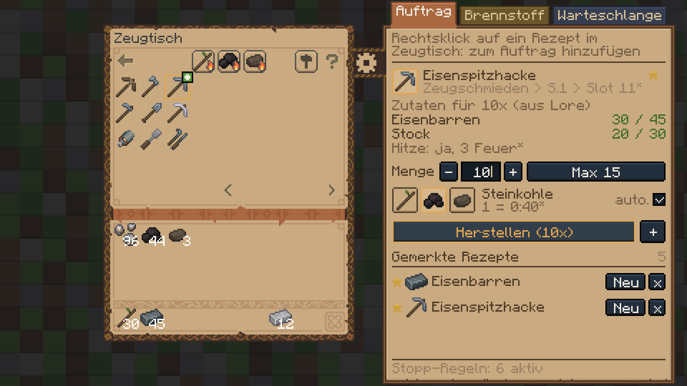
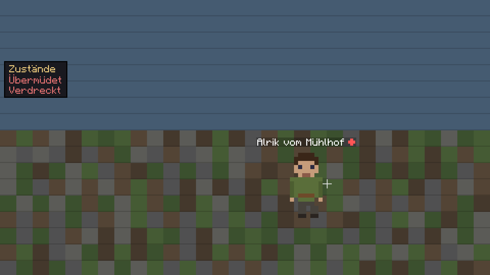
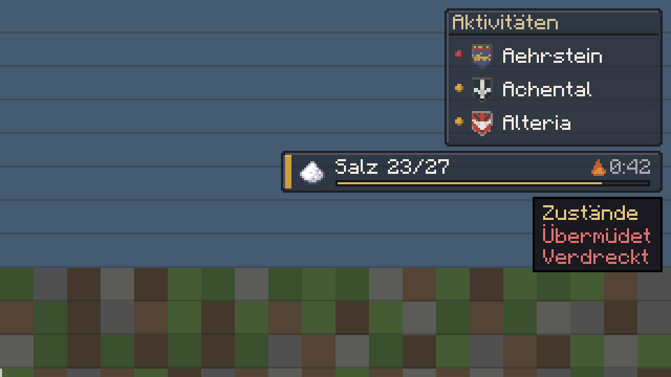
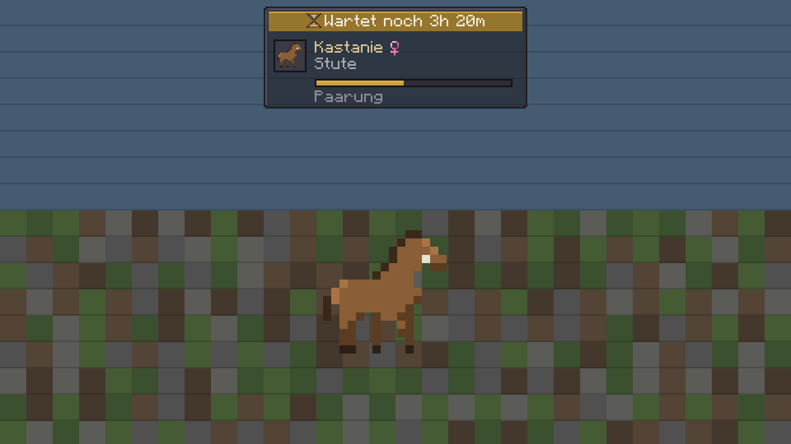
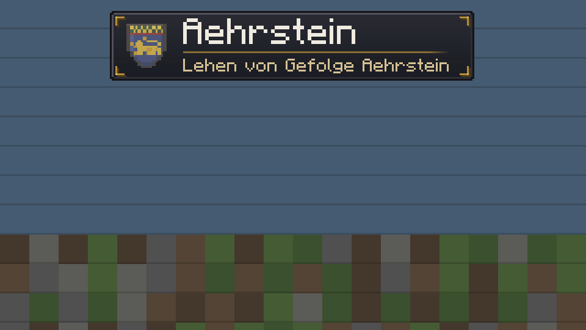

# Was ist neu in OttoExtra 0.18.0

OttoExtra 0.18.0 (derzeit als Vorabversion `0.18.0-alpha`) bringt eine neue Werkstatt für Herstellungsstationen, die Anzeige deiner Leiden und Zustände, ein aufgeräumteres HUD, Hof-Teilen per Code und einige Kleinigkeiten, die den Alltag angenehmer machen. Diese Seiten zeigen dir, was neu ist und wie du es benutzt.

> Hinweis zu den Bildern: Die Bilder auf diesen Seiten sind keine Spielfotos. Es sind nachgezeichnete Darstellungen und Entwürfe, die dem Aussehen im Spiel nachempfunden sind. Welche Teile Illustration sind (zum Beispiel Welt, Spielfigur und Pferd), steht jeweils unter dem Bild. Im Spiel kann etwas anders aussehen, vor allem hat Text dort teils einen Schatten.

## Wichtig beim Umstieg: nur noch ein Jar

Die früheren Zusatzmods **OttoExtra Resources** und **OttoExtra Tactical Factions** sind jetzt fester Bestandteil von OttoExtra. So gehst du vor:

1. Schließe Minecraft.
2. Lösche im `mods`-Ordner die alten Dateien `ottoextra_resources…jar` und `ottoextra_tacticalfactions…jar`.
3. Lege `ottoextra-0.18.0-alpha.jar` hinein (und lass Fabric API wie bisher dort liegen).
4. Starte Minecraft.

Deine Einstellungen und gespeicherten Daten bleiben an ihrem Ort und werden übernommen. Liegt noch ein altes Addon-Jar im Ordner, meldet Fabric beim Start einen Konflikt. Das ist Absicht, damit nichts doppelt geladen wird. Entferne dann einfach das alte Jar. Mehr dazu: [Integrierte Module](integrierte-module.md).

## Die Neuerungen im Überblick

### Werkstatt: Herstellen mit Seitenpanel

*Abbildung: Entwurf nach dem freigegebenen Design, keine Spielaufnahme.*

Ein Zahnrad-Reiter am Stationsfenster öffnet ein Panel, in dem du Rezepte, Mengen und Brennstoff planst. Standardmäßig ausgeschaltet. Der Dauerbetrieb darf nur genutzt werden, wenn die Serverregeln es erlauben. [Zur Seite „Werkstatt“](werkstatt.md)

### Leiden und Zustände

*Abbildung: Darstellung nach dem Client-Code; Spielfigur und Hintergrund sind Illustration.*

OttoExtra liest deine Leiden und Zustände unsichtbar aus dem Servermenü und kann sie mit anderen OttoExtra-Spielern teilen. [Zur Seite „Leiden und Zustände“](leiden-und-zustaende.md)

### HUD: nichts überlappt mehr

*Abbildung: nachgezeichnet. Das „Vorher“-Bild ist ein Beispiel für das alte Problem und steht auf der HUD-Seite.*

Anzeigen in derselben Spalte schieben sich gegenseitig weg, oben in der Mitte gibt es einen gemeinsamen Stapel, und die Vote-Erinnerung ist eine Karte mit „Später“-Taste. [Zur Seite „HUD“](hud.md)

### Tiere und Höfe

*Abbildung: Entwurf; das Pferd ist eine Illustration.*

Ausführliche Tierinfo als neuer Standard, 3/4-Vorschau, Höfe per Code teilen, Würfel für Tiernamen und ein sicherer Umgang mit defekten Tierbuch-Dateien. [Zur Seite „Tiere und Höfe“](tiere-und-hoefe.md)

### Regionsbanner im Stil „Plakette“

*Abbildung: nachberechnet; Wappen und Untertitel sind Beispiele.*

[Zur Seite „Regionsbanner“](region-banner.md)

### Resources und Tactical Factions sind eingebaut

Ein Jar statt drei, gespeicherte POIs erscheinen wieder in der Liste im Menübuch. [Zur Seite „Integrierte Module“](integrierte-module.md)

### Tab-Vervollständigung in Namensfeldern

Mit der Tabulatortaste vervollständigst du Spieler-, RP-, Gefolge-, Lehen- und Hofnamen. [Zur Seite „Tab-Vervollständigung“](tab-vervollstaendigung.md)

## Alle Seiten

- [Werkstatt](werkstatt.md)
- [Leiden und Zustände](leiden-und-zustaende.md)
- [HUD](hud.md)
- [Tiere und Höfe](tiere-und-hoefe.md)
- [Regionsbanner](region-banner.md)
- [Integrierte Module (Resources und Tactical Factions)](integrierte-module.md)
- [Tab-Vervollständigung](tab-vervollstaendigung.md)
- [Häufige Fragen und Fehlersuche (FAQ)](faq.md)

## Hinweis zum Stand

0.18.0-alpha ist eine Vorabversion zum Testen. Im Spiel noch nicht vollständig geprüft sind die Werkstatt auf allen Stationen, die unsichtbare Leiden-Prüfung unter Last und das Zusammenspiel der integrierten Module. Wenn dir etwas auffällt, melde es gern.

Die technische Liste aller Änderungen steht im [Changelog](../../../CHANGELOG.md).

Das Einstellungsbuch öffnest du über **ModMenu → OttoExtra** (oder über das Tastenkürzel, falls du eines vergeben hast). Die Pfade auf den Seiten nennen immer die Kategorie und den Abschnitt im Buch. Weitere Optionen sind teils hinter „Mehr Optionen“ eingeklappt.
