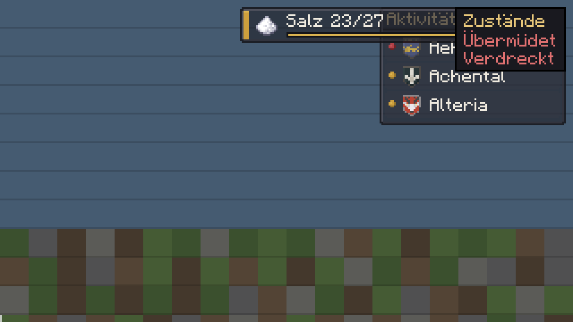
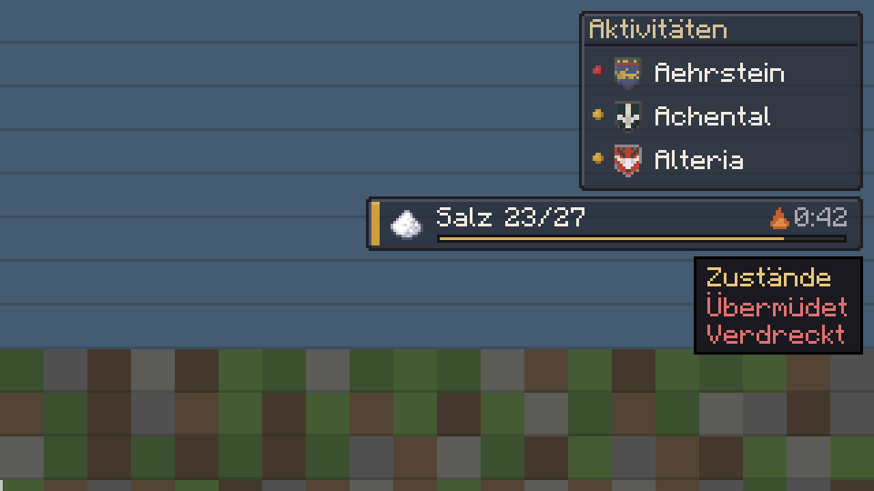
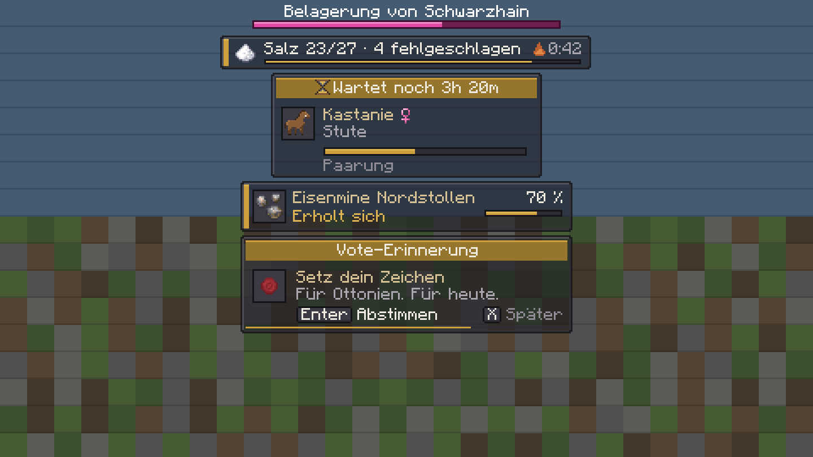
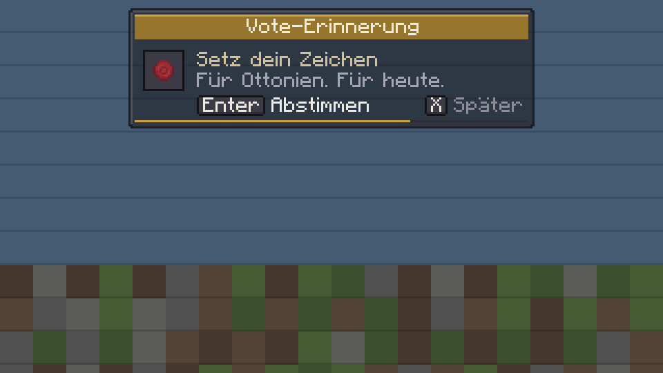

# HUD: Spalten, Stapel oben in der Mitte und neue Vote-Karte

In 0.18.0 verhalten sich die Anzeigen auf dem Bildschirm (HUDs) ordentlicher: Sie überlappen sich nicht mehr, oben in der Mitte gibt es einen gemeinsamen Stapel, und die Vote-Erinnerung ist eine Karte mit „Später“-Taste.

## Anzeigen schieben sich gegenseitig weg

Früher konnten zwei Anzeigen, die an derselben Stelle saßen (zum Beispiel beide oben rechts), einander verdecken. Jetzt gilt: **HUDs in derselben Spalte schieben sich gegenseitig**, mit 2 Pixel Abstand.

Vorher (das alte Problem):

*Abbildung: Illustration des Problems. Die Konfiguration mit drei Anzeigen oben rechts ist ein Beispiel.*

Nachher:

*Abbildung: nachgezeichnet. Die Reihenfolge der Anzeigen ist hier angenommen.*

Der Schalter dazu heißt **Anzeigen nicht überlappen lassen** und ist standardmäßig **an**. Du findest ihn im Einstellungsbuch unter **Allgemein → Anzeigen auf dem Bildschirm anordnen**. Dort öffnet auch **Anordnen…** den HUD-Editor (alternativ der Befehl `/ottoextra hud`). Minimap und Lehen-Anzeige bleiben, wo sie sind.

Im HUD-Editor ziehst du Anzeigen mit der Maus. Mausrad oder Ecke ändern die Größe, Pfeiltasten verschieben um 1 Pixel (mit Umschalt 10 Pixel), mit Alt rastet nichts ein, Esc geht zurück.

## Gemeinsamer Stapel oben in der Mitte

Oben in der Mitte stapeln sich jetzt **Werkstatt-Leiste, Tier-Toast, Zonen-Toast und Vote-Erinnerung** mit je 2 Pixel Abstand **unter den Bossleisten**. Die Reihenfolge ist: Werkstatt-Leiste zuerst, dann Tier-Toast, Zonen-Toast und Vote-Karte.

*Abbildung: Reihenfolge und Abstand nach dem Client-Code nachgezeichnet. Der Zonen-Hinweis stammt aus dem Modul Resources. Bossleisten-Titel und Namen sind Beispiele.*

Die Werkstatt-Leiste sitzt 4 Pixel unter der letzten sichtbaren Bossleiste. Wer die Leiste vorher nie verschoben hatte, wird einmalig nach oben Mitte umgestellt. Eine selbst gewählte Position bleibt erhalten.

## Vote-Erinnerung als Karte

Die Vote-Erinnerung erscheint als Karte mit Kopfband, wechselnden Sprüchen, Restzeit und zwei Tasten:

*Abbildung: nachgezeichnet nach dem Client-Code, Spruch beispielhaft.*

| Taste | Standard | Name in den Tasteneinstellungen |
| --- | --- | --- |
| Abstimmen | Enter | Ottonien-Vote-Seiten öffnen |
| Später | X (neu) | Vote-Erinnerung später |

Vor dem Öffnen der Vote-Seiten und dem Kopieren in die Zwischenablage fragt ein Bestätigungsdialog einmalig nach. Die Einstellungen findest du unter **Allgemein → Vote-Erinnerung**:

| Einstellung | Standard |
| --- | --- |
| Vote-Reminder aktivieren | an |
| Wiederholung (Minuten) | 30 |
| Anzeigedauer (Sekunden) | 10 |
| Resetstunde (Europe/Berlin), Experte | 4 |
| Verzögerung nach Join (Sekunden), Experte | 5 |

Weitere Entwürfe der Karte (gestapelt, erledigt) liegen unter [`docs/design/hud/vote/`](../../design/hud/vote/).

## Grenzen

- Der Stapel gilt nur oben in der Mitte. In anderen Spalten sorgt der Schalter „Anzeigen nicht überlappen lassen“ fürs Wegschieben.
- Wer eine Anzeige frei verschoben hat, behält die Position.

## FAQ

**Meine Anzeigen überlappen sich noch.**
Prüfe, ob **Anzeigen nicht überlappen lassen** an ist. Minimap und Lehen-Anzeige werden nicht verschoben, sie bleiben an ihrem Platz.

**Warum sitzt etwas anders als vorher?**
Anzeigen in derselben Spalte schieben sich jetzt weg. Mit dem HUD-Editor (`/ottoextra hud`) legst du die Plätze neu fest, mit **Zurücksetzen** gehst du zurück zum Standard.

**Wo ist die Werkstatt-Leiste?**
Oben in der Mitte unter den Bossleisten, nur während ein Auftrag läuft oder gerade endete und wenn **Auftragskarte im HUD** an ist (siehe [Werkstatt](werkstatt.md)).

**Wie schiebe ich die Vote-Karte weg?**
Drücke **X** („Später“). Die Taste lässt sich in den Minecraft-Tasteneinstellungen ändern. Mehr dazu in der [FAQ](faq.md).

**Warum öffnet Enter die Vote-Seiten?**
Enter ist die Standardtaste für „Abstimmen“. Davor kommt einmalig ein Bestätigungsdialog.

**Ich will keine Vote-Erinnerung.**
Schalte **Vote-Reminder aktivieren** aus oder verlängere die **Wiederholung**.

**Warum konfligiert „Später“ mit meiner Hotbar im Kreativmodus?**
X ist in Minecraft standardmäßig die Taste „Schnellleiste laden“ im Kreativmodus. Belege „Vote-Erinnerung später“ in den Tasteneinstellungen neu.
