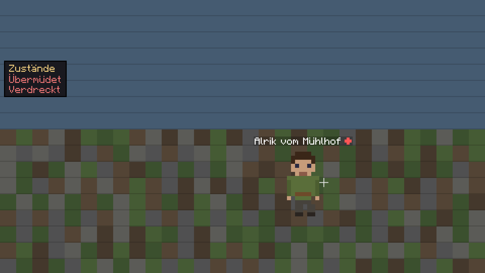

# Leiden und Zustände

OttoExtra liest deine eigenen **Leiden und Zustände** (zum Beispiel „Übermüdet“ oder „Verdreckt“) aus dem Servermenü. Du kannst sie in einer kleinen Liste im HUD sehen und, wenn du möchtest, mit anderen OttoExtra-Spielern teilen. Diese sehen dann am Namensschild ein Symbol.



*Abbildung: HUD und Symbol nach dem Client-Code nachgezeichnet. Die Spielfigur ist eine Illustration. Das HUD zeigt nur Namen, keine Wirkungen.*

## Was passiert im Hintergrund

- Nach dem Beitritt und danach alle **5 Minuten** öffnet OttoExtra dein Servermenü selbst und liest die Zustände. Das läuft **unsichtbar**: kein Fenster, keine Chatzeile, kein sichtbarer Wechsel des Hotbar-Slots.
- Die Prüfung **pausiert**, wenn du kämpfst oder gerade Schaden genommen hast, ein Fenster offen ist, du dich bewegst, fliegst oder reitest, das Spielfenster nicht aktiv ist, du angelst oder einen Gegenstand benutzt oder ein Werkstatt-Auftrag läuft. Sie wird dann später erneut versucht.
- Das Menü-Item des Servers muss dafür **in deiner Schnellleiste** liegen. Ohne dieses Item kann nicht geprüft werden.

## Einstellungen

Einstellungsbuch → **Allgemein → Leiden und Zustände**

| Schalter | Standard | Bedeutung |
| --- | --- | --- |
| Zustände teilen | an | Teilt deinen Stand mit anderen OttoExtra-Spielern (Voraussetzungen siehe unten) |
| Zustände anderer anzeigen | an | Symbol am Namensschild von Spielern, die teilen |
| Eigene Zustände im HUD | aus | Kleine Liste deiner Leiden und Zustände |
| Menü regelmäßig kurz öffnen | an | Automatische Prüfung (unter „Mehr Optionen“) |
| Menüprüfung unsichtbar | an | Ohne sichtbares Fenster und ohne Chatzeile „Du öffnest dein Menü“ (unter „Mehr Optionen“) |
| Prüfintervall (Minuten) | 5 | Abstand der automatischen Prüfung (unter „Mehr Optionen“) |
| Adresse des Zustandsdienstes | https://ottoextra.dev | Nur für Tests ändern (Experten-Einstellung) |

Ist „Menüprüfung unsichtbar“ aus, öffnet sich das Menü bei jeder Prüfung kurz sichtbar.

Die HUD-Liste lässt sich wie die anderen Anzeigen verschieben: `/ottoextra hud`, Eintrag „Eigene Zustände“.

## Sofort prüfen

Mit dem Befehl

```text
/ottoextra leiden check
```

prüfst du sofort und bekommst das Ergebnis im Chat, zum Beispiel „2 Zustände gelesen: Übermüdet, Verdreckt“ oder „Keine Zustände gelesen.“ Geht es gerade nicht, steht dort „Prüfung nicht möglich: <Grund>“. Der Grund wird derzeit auf Englisch angezeigt. Siehe [FAQ](faq.md).

## Teilen und Datenschutz

Das Teilen läuft über ottoextra.dev und ist **standardmäßig an**, kann aber jederzeit abgeschaltet werden. Es gilt:

- Es braucht deine **Einwilligung für Online-Dienste** (im Einstellungsbuch unter Datenschutz & Sicherung → Einwilligungen) und ein **verknüpftes Konto** (`/ottoextra verify`). Ohne beides wird nichts gesendet.
- **Nur dein eigener Client** schreibt deinen eigenen Stand. Niemand sonst kann ihn für dich eintragen.
- Schaltest du **Zustände teilen** aus, wird dein Stand **sofort gelöscht**.
- Ein Stand **verfällt nach 20 Minuten** ohne Erneuerung (dein Client meldet sich alle 5 Minuten) und wird danach nicht mehr ausgeliefert. Abgelaufene Stände werden täglich gelöscht.
- Andere sehen nur ein Symbol am Namensschild: ein **rotes ✚** für Leiden, ein **türkises ✦** für sonstige Zustände.

## FAQ

**Warum blitzt das Menü nicht mehr auf?**
Die Prüfung ist jetzt unsichtbar. Der Server bekommt das Öffnen des Menüs trotzdem mit, du siehst aber kein Fenster, keine Chatzeile und keinen Slotwechsel. Willst du die alte Variante, schalte **Menüprüfung unsichtbar** aus.

**Wird mein Zustand geteilt, ohne dass ich es weiß?**
Teilen ist standardmäßig an, geschieht aber nur mit deiner Einwilligung für Online-Dienste und einem verknüpften Konto. Du kannst es jederzeit unter **Zustände teilen** ausschalten. Dann wird dein Stand sofort gelöscht.

**Wie lange sieht jemand meinen Stand?**
Solange du teilst, wird er alle 5 Minuten erneuert. Nach 20 Minuten ohne Erneuerung (etwa nach dem Ausloggen) verfällt er.

**Können andere meinen Stand fälschen oder ändern?**
Nein, nur dein eigener Client schreibt deinen eigenen Stand.

**Ich sehe kein Symbol bei anderen Spielern.**
Dann teilen sie nicht, haben keine Einwilligung oder kein verknüpftes Konto, oder **Zustände anderer anzeigen** ist bei dir aus. Auch erscheinen nur OttoExtra-Spieler.

**Der Befehl sagt „Prüfung nicht möglich“.**
Lies den Grund dahinter. Häufig: Du bewegst dich, ein Fenster ist offen, du bist im Kampf, oder das Menü-Item liegt nicht in der Schnellleiste. Warte kurz oder behebe es und gib den Befehl erneut ein.

**Welche Zustände sehe ich im HUD?**
Nur die Namen deiner aktuellen Leiden und Zustände. Wirkungen zeigt die Liste nicht. Das HUD ist standardmäßig aus (**Eigene Zustände im HUD**).

**Funktioniert das auf anderen Servern?**
Nein, die Prüfung läuft nur auf Ottonien.
