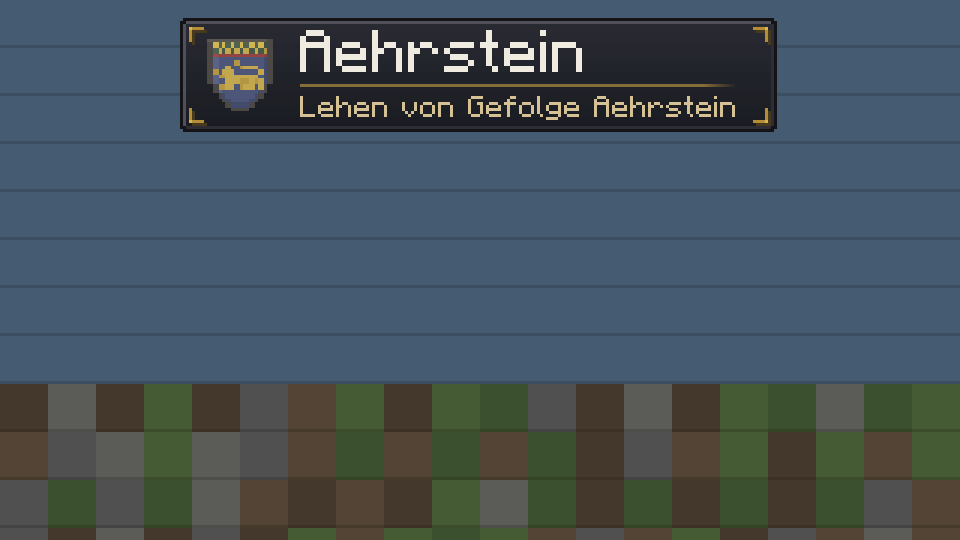

# Regionsbanner: Stil „Plakette“

Betrittst du ein Lehen, zeigt OttoExtra eine Einblendung mit Wappen und Namen. In 0.18.0 ist der Standardstil jetzt die **Plakette**.

*Abbildung: nach dem Stil „Plakette“ nachberechnet, ohne den Glanz der Einblendung. Wappen und Untertitel sind Beispiele.*

## Was sich geändert hat

- Neuer Standard: **Plakette**.
- Hattest du bisher **Klassisch (Kasten)** eingestellt, wird einmalig auf „Plakette“ umgestellt. Wählst du danach wieder „Klassisch“, bleibt das so.
- Andere Stile, die du selbst gewählt hattest, bleiben unverändert.

## Stil ändern

Einstellungsbuch → **Lehen & Regionen → Aussehen der Einblendung → Banner-Stil** (in der Hilfe der Option „Stil der Einblendung“).

Zur Auswahl stehen: **Klassisch (Kasten)**, **Zonentitel**, **Banderole**, **Plakette** (Standard) und **Schlicht**. „Klassisch“ ist ein Kasten, dessen Farben du unter „Farbschema“ wählst. Die anderen Stile sind fertig gestaltet.

Dieselbe Seite bietet auch Position und Farbschema der Einblendung. Mit der Vorschau im Einstellungsbuch siehst du das Ergebnis sofort. Die Einblendung selbst schaltest du unter **Einblendung beim Betreten** an oder aus.

## FAQ

**Warum sieht mein Banner anders aus?**
Der Standard ist jetzt „Plakette“. Wer „Klassisch“ eingestellt hatte, wurde einmalig umgestellt.

**Wie bekomme ich den alten Kasten zurück?**
Wähle unter **Banner-Stil** wieder **Klassisch (Kasten)**. Das bleibt dann so.

**Das Wappen fehlt.**
Wappen werden aus dem Banner des Lehens geladen und lokal zwischengespeichert. Fehlt es, kann das Herunterladen von Banner-Bildern in den Einwilligungen ausgeschaltet sein (Datenschutz & Sicherung → Einwilligungen).

**Kann ich die Einblendung ausschalten?**
Ja, unter **Lehen & Regionen → Einblendung beim Betreten**.

**Wo steht die Einblendung?**
Je nach Einstellung oben rechts, links, mittig oder zentriert. Du kannst sie auch im HUD-Editor (`/ottoextra hud`) verschieben.
