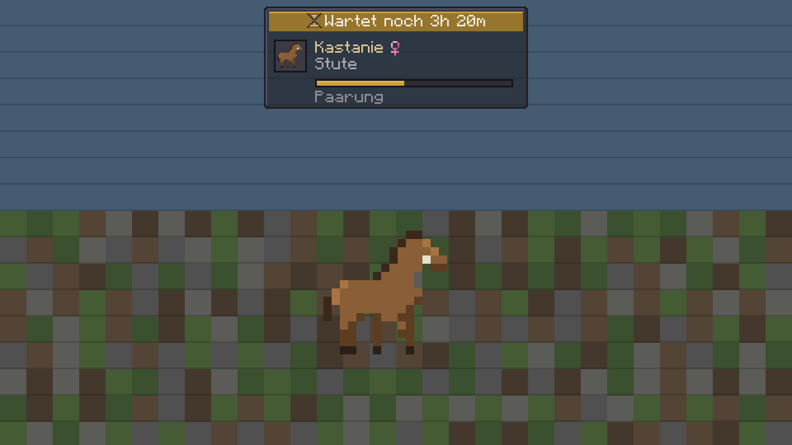

# Tiere und Höfe

In 0.18.0 gibt es mehrere Neuerungen rund um Tiere: eine ausführliche Tierinfo als Standard, eine bessere Tiervorschau, das Teilen von Höfen per Code, einen Würfel für Tiernamen und mehr Sicherheit für dein Tierbuch.



*Abbildung: Entwurf der ausführlichen Tierinfo. Das Pferd in der Welt und im Porträt ist eine Illustration. Im Spiel hat der Text einen Schatten.*

## Tierinfo im neuen, ausführlichen Stil

Wenn du ein Tier kurz ansiehst, zeigt OttoExtra oben auf dem Bildschirm eine Karte mit den wichtigsten Werten. Neu ist: **Alle starten einmalig im Stil „Ausführlich“** (Karte mit Statusband und Fortschrittsbalken).

- Hattest du ein **eigenes Layout** gebaut, bleibt es gespeichert. Du wählst es unter **Darstellung → Eigenes Layout** wieder aus.
- Die schmale Variante gibt es weiter als **Kompakt**.

Einstellungsbuch → **Tiere & Hof → Tierinfo beim Anvisieren**

| Einstellung | Standard |
| --- | --- |
| Tierinfo beim Ansehen | an |
| Darstellung | Ausführlich (Kompakt, Ausführlich oder Eigenes Layout) |
| Eigenes Reittier ausblenden (unter „Mehr Optionen“) | an |

**Eigenes Reittier ausblenden:** Zeigt keine Tierinfo für das Tier, auf dem du gerade reitest. Beim Reiten eines Pferdes oder Esels werden ohnehin keine Abfragen gestellt.

## Tiervorschau in 3/4-Ansicht

In der Tierinfo und im Tierbuch wird das Tier jetzt in einer **3/4-Ansicht** gezeigt, passend in das Vorschaufeld eingepasst und **ohne Namensschild**. Dafür musst du nichts einstellen.

## Namen würfeln

Im Tierregister sitzt neben dem Tiernamen ein **Würfel**. Er schlägt einen zufälligen Namen vor, dazu Vorschläge für Fellfarbe und Zeichnung. Du bedienst ihn mit der Maus oder mit Tab und Enter beziehungsweise Leertaste.

- Der Katalog hat 166 weibliche und 167 männliche Grundnamen.
- Beim nächsten Würfeln wird der bisherige Vorschlag möglichst nicht wiederholt, und Namen, die du schon vergeben hast, werden vermieden, solange freie Vorschläge da sind.
- Erst **Speichern** ändert den Namen des Tiers. Würfeln allein ändert nichts.

## Höfe teilen per Code

Du kannst Höfe mit anderen teilen, **ohne Konto**. Eine geteilte Liste enthält Name, Notiz und Symbol der Höfe und für ihre Tiere die Hofzuordnung, die Notiz und die Beschriftung (den Registernamen).

**Nie gesendet werden:** Werte der Ottonien-API (Mast, Zucht, Tempo, Sprung, Leben, Besitzer), Beobachtungen und dein lokaler API-Schlüssel.

### Teilen

1. Öffne die Tierübersicht und wähle auf der Höfe-Seite einen **eigenen Hof**.
2. Klicke rechts oben auf **Teilen**.
3. Es erscheinen zwei Codes:
   - **Für deine Gruppe** (sehen und bearbeiten). Dieser Code ist **wie ein Passwort**. Wer ihn hat, kann die Höfe der Liste ändern. Gib ihn nur an Vertraute.
   - **Für andere** (nur ansehen). Dieser Lesecode **beginnt mit `H`**.
4. Mit **Kopieren** übernimmst du den Code, mit **Link** einen Link der Form `https://ottoextra.dev/h/<Code>`.
5. Weitere eigene Höfe fügst du per Klick auf ihren Chip hinzu oder entfernst sie. Ein Hof gehört höchstens zu einer eigenen Liste.

### Beitreten

- Tippe den Code im Feld **Code von jemand anderem** links ein und klicke **Beitreten**, oder nutze den Befehl:

```text
/ottoextra tiere beitreten <Code>
```

- Mit dem **Lesecode** ist die Liste schreibgeschützt („nur lesen“). Mit dem **Gruppencode** kannst du Name, Notiz und Symbol der geteilten Höfe ändern (Klick auf den Hofnamen).

### Abgleich und Konflikte

- Der Abgleich läuft etwa **alle 30 Sekunden** je Liste. Bei Fehlern wird nach 30 Sekunden neu versucht.
- Ändern zwei Personen dasselbe, **gewinnt die neuere Änderung**.
- Änderungen anderer an Notiz und Symbol deiner Höfe oder an Tiernotizen kommen in dein lokales Tierbuch.
- Pro Server sind höchstens 20 geteilte Listen möglich.

### Codes erneuern und aufhören

- **Codes erneuern** (zweimal klicken) erzeugt neue Codes. Die alten gelten nicht mehr.
- **Nicht mehr teilen** (eigene Liste) oder **Verlassen** (fremde Liste), jeweils zweimal klicken, beendet das Teilen nur **auf deinem Gerät**.

### Datenschutz

- Teilen und Beitreten brauchen die **Einwilligung für Online-Dienste**. Ohne sie findet kein Kontakt zum Dienst statt.
- Mit einem Lesecode sendet dein Client nichts.
- Behandle den Gruppencode wie ein Passwort. Erneuere ihn, wenn er an Unbefugte geraten ist.

## Sichere Tierbuch-Datei

Das Tierbuch ist deine lokale Datei mit Höfen, Notizen und Tieren. Ist sie **defekt oder zu groß** (über 16 MB), wird sie nicht überschrieben, sondern unter dem Namen `<Dateiname>.broken-<Zahl>.json` gesichert, und OttoExtra beginnt mit einem leeren Tierbuch. Die neuesten drei Sicherungen bleiben erhalten. Gelingt das Sichern nicht, schreibt OttoExtra gar nichts, damit nichts verloren geht.

## FAQ

**Warum sieht meine Tierinfo plötzlich anders aus?**
Alle starten einmalig im Stil „Ausführlich“. Unter **Darstellung** wählst du **Kompakt** oder dein **Eigenes Layout**, das weiterhin gespeichert ist.

**Ich sehe keine Tierinfo für mein Reittier.**
Das ist Absicht: **Eigenes Reittier ausblenden** ist an. Schalte es unter „Mehr Optionen“ aus, wenn du es sehen willst.

**Brauche ich ein verknüpftes Konto, um Höfe zu teilen?**
Nein. Du brauchst nur die Einwilligung für Online-Dienste.

**Was ist der Unterschied zwischen den beiden Codes?**
Der Gruppencode erlaubt sehen und bearbeiten, der Lesecode (beginnt mit `H`) nur ansehen. Gib den Lesecode weiter, wenn andere nur schauen sollen.

**Jemand hat meinen Gruppencode. Was nun?**
Klicke zweimal auf **Codes erneuern**. Die alten Codes gelten danach nicht mehr.

**Beitreten klappt nicht („Ungültiger Code“).**
Prüfe auf Tippfehler. Meldet sich „Beitreten braucht die Zustimmung zu Online-Diensten“, schalte die Einwilligung im Einstellungsbuch unter Datenschutz & Sicherung ein. „Zu viele geteilte Listen auf diesem Server“ heißt: Das Limit von 20 Listen ist erreicht.

**Zwei Personen haben denselben Hof geändert. Wer gewinnt?**
Die neuere Änderung.

**Mein Tierbuch war defekt. Sind meine Daten weg?**
Nein. Die alte Datei liegt als `….broken-….json` neben dem neuen Tierbuch. Die neuesten drei Sicherungen bleiben erhalten.

**Warum hat das Vorschau-Tier kein Namensschild?**
Die 3/4-Vorschau zeigt das Tier absichtlich ohne Namensschild, damit es ins Feld passt.
