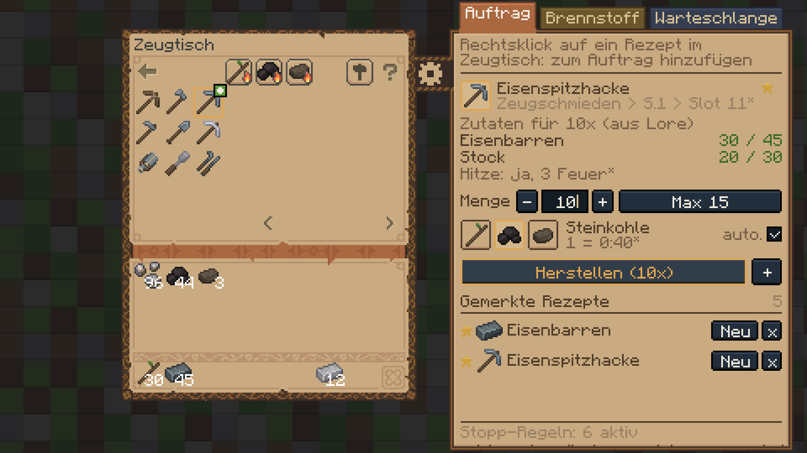
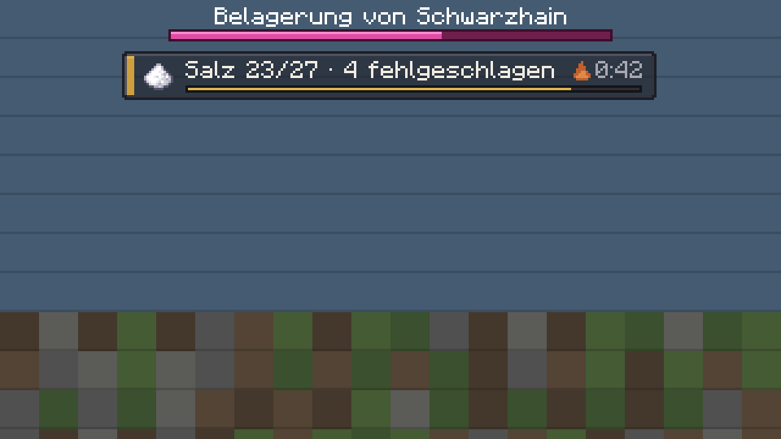
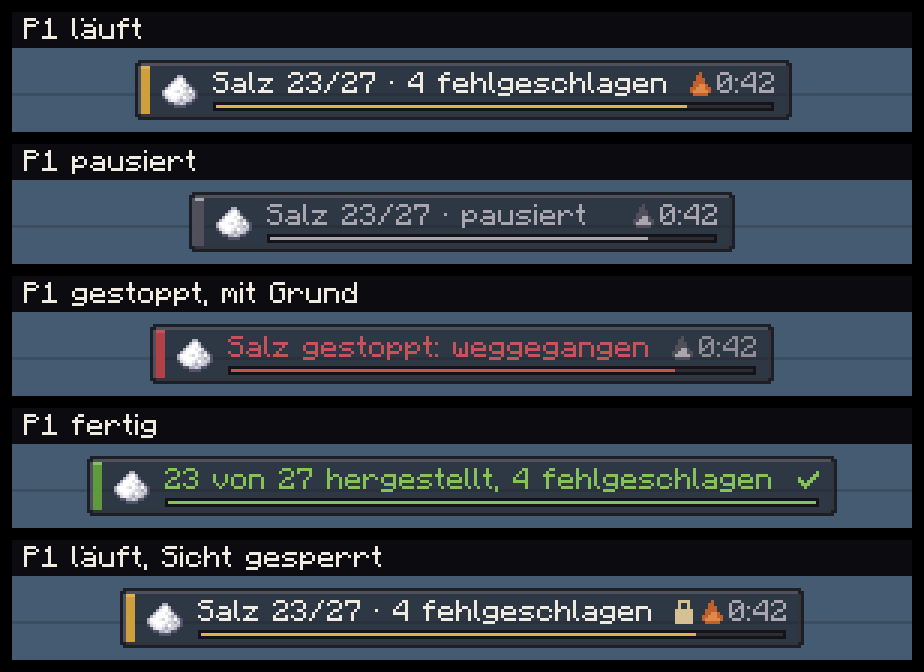

# Werkstatt

Die Werkstatt hilft dir an den Herstellungsstationen (Zeugtisch, Kochstelle, Schmiedetische und so weiter, auch in Untermenüs wie „Mehr Sonstiges“ oder „Mehr Pigmente“). Du siehst in einem Seitenpanel, was ein Rezept braucht, wie viel du davon herstellen kannst, und du kannst Aufträge in eine Warteschlange legen.

*Abbildung: Entwurf nach dem freigegebenen Design (Reiter „T2“), keine Spielaufnahme. Das Panel wurde nicht Zeile für Zeile mit dem Spiel verglichen.*

## Wichtig vorab: Serverregeln

Die Werkstatt tut nur, was du auch selbst klicken könntest, und zwar offen und in festen Takten. Trotzdem gilt:

- Die ganze Werkstatt ist **standardmäßig ausgeschaltet**.
- Der **Dauerbetrieb** (Aufträge laufen von allein, Station wird erneut geöffnet, Feuer nachgelegt) ist ebenfalls **standardmäßig aus**.
- Schalte den Dauerbetrieb **nur ein, wenn die Serverregeln das erlauben.** Das Panel erinnert dich in seiner Fußzeile daran. Im Zweifel frage das Team.

## Einschalten

1. Öffne das Einstellungsbuch (ModMenu → OttoExtra).
2. Gehe zu **Handwerk & Bauen → Werkstatt (Herstellungsstationen)**.
3. Schalte **Werkstatt-Panel** ein.
4. Nur wenn erlaubt: Schalte **Dauerbetrieb** ein.

Weitere Schalter im selben Abschnitt:

| Schalter | Standard | Bedeutung |
| --- | --- | --- |
| Werkstatt-Panel | aus | Reiter mit Seitenpanel an den Stationen |
| Dauerbetrieb | aus | Aufträge laufen selbstständig |
| Sicht im Dauerbetrieb sperren | an | Maussicht und Bewegungstasten sind gesperrt, solange der Dauerbetrieb läuft |
| Auftragskarte im HUD | an | Fortschrittsleiste oben mittig, wenn die Station geschlossen ist |
| Stopp bei Fokusverlust | an | Dauerbetrieb stoppt, wenn das Spielfenster den Fokus verliert |

## So benutzt du die Werkstatt

1. Öffne eine Herstellungsstation wie gewohnt. Am Rand des Fensters sitzt ein Reiter mit Zahnrad. Ein Klick klappt das Panel auf.
2. **Rechtsklick auf ein Rezept** in der Station legt es als Auftrag an. Der Rechtsklick wird nur im Spiel abgefangen und nie an den Server geschickt. Linksklicks bleiben unverändert.
3. Im Panel stehen drei Reiter:
   - **Auftrag:** das gewählte Rezept mit den Zutaten für die gewählte Menge (vorhanden / nötig), Hitze, Ertrag, die **Menge** (`-`, `+`, mit Umschalt in Zehnerschritten, oder **Max**), die Brennstoffwahl und der Knopf **Herstellen**. Mit dem Stern merkst du Rezepte unter „Gemerkte Rezepte“.
   - **Brennstoff:** die Feuer-Knöpfe der Seite mit Brenndauer, Vorrat und dem Schalter **auto. nachlegen**.
   - **Warteschlange:** alle Aufträge dieser Station. Du kannst sie umsortieren und entfernen, **Alle starten** (nur im Dauerbetrieb) und siehst die Stopp-Regeln.
4. Ohne Dauerbetrieb zeigt das Panel Rezepte, Zutaten, Feuer und Höchstmenge und bietet **1x herstellen**: genau ein Klick auf das Rezept (bei Bedarf vorher ein Feuerklick) auf der offenen Seite.
5. Mit Dauerbetrieb klickt die Werkstatt Durchgang für Durchgang selbst und öffnet die Station nach jedem Rezept per Rechtsklick wieder. Die Station muss dafür in Reichweite bleiben.

Bei geschlossenem Panel zeigt ein kleines Abzeichen neben dem Reiter den Stand, zum Beispiel `6/20` mit Flamme, einen roten Punkt nach einem Stopp oder die Zahl wartender Aufträge.

## Menge zählt Durchgänge, Fehlschläge gehören dazu

Bei Ottonien kann eine Herstellung misslingen. Die Werkstatt behandelt das als normalen Ablauf:

- Die Menge, die du einstellst, sind **Durchgänge**.
- Ein Fehlschlag zählt als Durchgang und wird **nicht nachgeholt**.
- Am Ende steht zum Beispiel: „23 von 27 hergestellt, 4 fehlgeschlagen“.
- Der Auftrag stoppt von sich aus, wenn es **drei Fehlschläge in Folge** gibt.

## Die Fortschrittsleiste

Solange ein Auftrag läuft, pausiert, gestoppt oder gerade fertig ist (15 Sekunden) und kein Fenster offen ist, zeigt eine schmale Leiste oben in der Mitte den Stand. Sie rückt unter Bossleisten.

*Abbildung: nachgezeichnet nach dem Client-Code. Bossleiste und Hintergrund sind Beispiele.*

Die Zustände der Leiste (läuft, pausiert, gestoppt mit Grund, fertig, Sicht gesperrt) siehst du hier im Entwurf:

*Abbildung: Entwurf (Design-Mock-up), keine Spielaufnahme.*

## Wann stoppt ein Auftrag?

Die Werkstatt stoppt im Dauerbetrieb, wenn:

- du **Schaden** erleidest oder **stirbst**,
- du **weggehst** (die Station ist nicht mehr in Reichweite),
- ein **fremdes Fenster** aufgeht,
- du **Esc** drückst oder den Auftrag mit **Stopp** beendest,
- Zutaten oder Brennstoff fehlen, das Inventar voll ist oder der Server ablehnt,
- es drei Fehlschläge in Folge gibt,
- das Spielfenster den Fokus verliert (abschaltbar).

Nur **exakte Servermeldungen** zählen. Was andere Spieler im Chat schreiben, stoppt keinen Auftrag.

Stoppen kannst du außerdem mit dem Befehl `/ottoextra werkstatt stop`. Zusätzlich gibt es die Taste **Werkstatt: Auftrag stoppen**; sie ist standardmäßig nicht belegt und lässt sich in den Minecraft-Tasteneinstellungen vergeben.

## Sichtsperre im Dauerbetrieb

Solange der Dauerbetrieb läuft und **Sicht im Dauerbetrieb sperren** an ist, drehen Mausbewegungen die Sicht nicht, und Laufen, Springen und Schleichen sind gesperrt. So bleibt die Station in Reichweite. Stopp-Taste, Befehl, Esc und Chat bleiben nutzbar.

## Feuer

Der Server zeigt nicht an, wie lange das Feuer noch brennt. Die Werkstatt schätzt es: Zu Beginn wird einmal angezündet, jeder eigene Feuerklick zählt die Brenndauer dazu. Die Schätzung ist deshalb nur ein Richtwert.

## Grenzen und bekannte Punkte

- Die Rezepte liest die Werkstatt aus den Beschreibungstexten der Server-Knöpfe. Sind die Zutaten dort nicht lesbar, steht im Panel „Zutaten unbekannt – nur Menge, stoppt wenn Server ablehnt“.
- Aufträge gehören zu der Station, an der du sie angelegt hast, und laufen nur dort.
- In der Vorabversion noch nicht auf allen Stationen im Spiel geprüft.

## FAQ

**Darf ich die Werkstatt benutzen?**
Das Panel (Planen, Zutaten ansehen, „1x herstellen“) ist unkritisch, weil es nur einen Klick für dich macht. Den **Dauerbetrieb** darfst du nur nutzen, wenn die Serverregeln es erlauben. Er ist deshalb standardmäßig aus.

**Warum zählt ein Fehlschlag als Durchgang?**
Weil Fehlschläge bei Ottonien zum Herstellen dazugehören. Die Menge sind Durchgänge, nicht garantierte Ergebnisse. Nachholen würde zu unvorhersehbar viel Material verbrauchen. Das Ergebnis siehst du am Ende: „23 von 27 hergestellt, 4 fehlgeschlagen“.

**Warum ist mein Auftrag plötzlich gestoppt?**
Die Leiste und das Panel nennen den Grund, zum Beispiel „weggegangen“, „Zutaten fehlen“ oder „zu viele Fehlschläge in Folge“. Behebe den Grund und klicke **Fortsetzen**.

**Ich kann mich nicht mehr umsehen oder laufen. Ist etwas kaputt?**
Nein, das ist die Sichtsperre im Dauerbetrieb. Beende den Auftrag mit Esc, `/ottoextra werkstatt stop` oder dem Stopp-Knopf, oder schalte **Sicht im Dauerbetrieb sperren** aus.

**Was passiert, wenn ich im Chat „stop“ schreibe oder jemand anderes etwas schreibt?**
Nichts. Spielerchat stoppt keinen Auftrag. Es zählen nur exakte Servermeldungen.

**Wo ist die Fortschrittsleiste?**
Oben in der Mitte, unter den Bossleisten. Sie erscheint nur, solange keine Station offen ist, und nur, wenn **Auftragskarte im HUD** an ist. Du kannst sie im HUD-Editor verschieben (`/ottoextra hud`).

**Warum kommt „Station nicht in Reichweite“?**
Der Dauerbetrieb öffnet den Block wieder, den du selbst benutzt hast. Ist er zu weit weg, stoppt der Auftrag. Bleibe in Reichweite.

**Wird die Werkstatt auch etwas anderes als Herstellen für mich tun?**
Nein. Sie öffnet die Station, legt Feuer nach und klickt das Rezept, mehr nicht.
